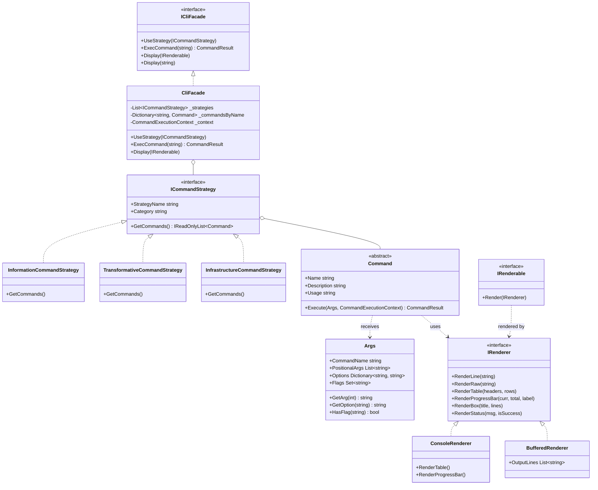

# Software Design Document (SDD)
## Subsystem: Command-Line Interface (CLI Facade & Strategies)

**Project Name:** Modular Application Platform & RPG Character Engine  
**Module:** User Interface / Presentation Layer (Practical Work 13)  
**Architecture Style:** Clean Architecture with Strategy, Facade, and Inverted Rendering Patterns  
**Language & Platform:** C# 12, .NET 8.0, xUnit  
**Status:** Approved & Finalized  

---

## 1. Executive Summary & Purpose

The purpose of this design document is to specify the architectural design, component contracts, and implementation details for the Command-Line Interface (CLI) subsystem. 
In enterprise and modular systems, the CLI serves multiple roles:
1. **Primary Text-based User Interface:** Fast, keyboard-driven access to domain features.
2. **Development & Debugging Console:** Direct introspection of internal states, checkpoints, and REST API syncs.
3. **Bridge to Future Graphical UI:** Well-encapsulated CLI commands map directly to UI view models, text areas, or desktop windows.

---

## 2. High-Level Architectural Context

The system adheres strictly to Clean Architecture principles, isolating the presentation layer from domain rules:

```
┌────────────────────────────────────────────────────────────────────────┐
│                      PRESENTATION LAYER (CLI)                          │
│   CliFacade • ICommandStrategy • Command • Args • IRenderer • CLIGraphic│
└─────────────────────────────────┬──────────────────────────────────────┘
                                  │ (commands invoke domain facades)
                                  ▼
┌────────────────────────────────────────────────────────────────────────┐
│                        CORE DOMAIN LAYER                               │
│   Game Facade • BattleMediator • Character • Item • Ability • Memento  │
└─────────────────────────────────┬──────────────────────────────────────┘
                                  │ (persistence & remote calls)
                                  ▼
┌────────────────────────────────────────────────────────────────────────┐
│                     INFRASTRUCTURE LAYER                               │
│   JsonRepositoryService • GenshinApiClient • ConsoleDisplayer • DTOs    │
└────────────────────────────────────────────────────────────────────────┘
```

---

## 3. CLI Class Hierarchy & Design Patterns

### 3.1 Mermaid Class Diagram



---

## 4. Key Design Decisions

### 4.1 Inverted Rendering Dependency (IRenderer / IRenderable)
Rather than formatting domain objects directly in domain classes or tightly coupling DTOs to `System.Console`:
- `IRenderer` declares the presentation capabilities provided by the CLI (lines, tables, alert boxes, progress indicators).
- `IRenderable` allows domain-layer DTOs (`CharacterDto`, `ItemDto`, `AbilityDto`) to receive an `IRenderer` and stream their contents without depending on concrete terminal libraries.

### 4.2 Decoupled Tokenization via `Args`
`ArgsParser` implements regular expression tokenization to support:
- Quoted strings with spaces: `create-char "Gandalf the Grey" 120 25`
- Key-value options: `--avatar "https://images.org/avatar.png"`
- Boolean switches: `--critical`, `--pierce`

### 4.3 Command Taxonomy via Strategy Pattern
Commands are divided into three distinct operational strategies:
1. **Information Strategy (Query):**
   - `chars`: Formats an ASCII table with ID, Name, Health, Power, Resistance, and visual avatar links.
   - `char <id>`: Displays a detailed boxed profile card.
   - `items`: Catalogs items and current equippers.
   - `abilities`: Catalogs skills and damage/healing metrics.
2. **Transformative Strategy (Action / Game):**
   - `create-char`: Instantiates characters through CLI arguments or interactive prompts.
   - `equip` & `learn`: Modifies equipment and skills.
   - `attack`, `heal`, `cast`: Executes turns in the combat engine.
   - `start-game`: Initializes a duel arena between selected fighters.
3. **Infrastructure Strategy (System / Persistence / API):**
   - `save` & `load`: Reads and writes snapshots to JSON repository.
   - `api-import`: Synchronizes external REST API character and weapon data with visual progress bar updates.
   - `api-query`: Direct query of remote REST API endpoints.
   - `status`: Displays real-time memory and persistence diagnostics.

---

## 5. Visual Terminal Components (`CLIGraphic`)

The subsystem provides three reusable graphic formatters:
- `CLIGraphic.FormatTable`: Dynamic column sizing, Unicode borders (`┌─┬┐`, `├─┼┤`, `└─┴┘`), and text padding.
- `CLIGraphic.FormatProgressBar`: Visual progress bar `[████████░░░░░░░░] 50% (5/10)` for asynchronous operations.
- `CLIGraphic.FormatBox`: Double-line alert frames (`╔══╗`, `║  ║`, `╚══╝`) with centered headers.

---

## 6. Testability & Quality Attributes

1. **Deterministic Unit Testing:** `BufferedRenderer` captures all output in-memory. Commands can be invoked and verified with zero console side-effects.
2. **Extensibility (Open/Closed Principle):** Adding a new command set (e.g. `NetworkCommandStrategy` or `EconomyCommandStrategy`) requires zero modifications to `CliFacade` or existing commands.
3. **Fault Tolerance:** Unhandled exceptions in commands are captured gracefully by `CliFacade.ExecCommand`, returning `CommandResult.Fail` and rendering formatted error notices without crashing the host process.
